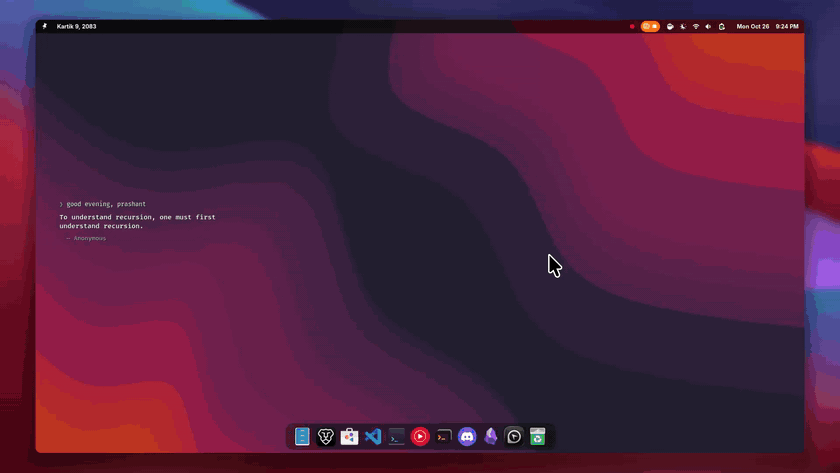
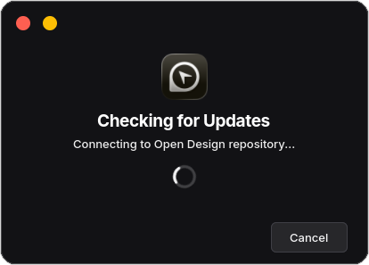
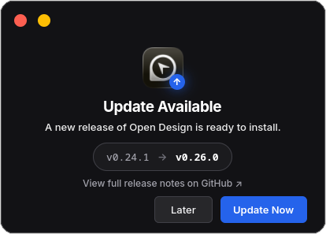
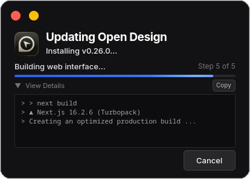
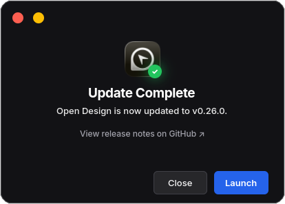

<div align="center">
  
  <h3>Open Design Desktop for Linux</h3>
  <p>A native Linux launcher and updater for Open Design.</p>
</div>

---

### Overview

[Open Design](https://github.com/nexu-io/open-design) currently publishes prebuilt desktop releases only for macOS and Windows. This project builds it from source and runs it as a standalone desktop app on Linux.

- **Fast Startup**: Runs the production build and manages the background server automatically.
- **Dedicated App Window**: Opens in an isolated Chromium app-mode profile, separate from your personal browser.
- **Dark Mode via Extensions**: Supports installing Chromium extensions, including dark mode extensions, inside the app profile.
- **Desktop & Dock Integration**: Appears in your application launcher with its own icon and right-click quick actions.
- **Native GTK4 Updater**: Checks for upstream releases, streams live build logs, and updates in place.

<p align="center">
  
</p>

<table>
<tr>
<td width="50%" align="center" valign="middle">

</td>
<td width="50%" align="center" valign="middle">

</td>
</tr>
<tr>
<td width="50%" align="center"><sub>Checks upstream for the latest stable release</sub></td>
<td width="50%" align="center"><sub>Version comparison with link to release notes</sub></td>
</tr>
<tr>
<td width="50%" align="center" valign="middle">

</td>
<td width="50%" align="center" valign="middle">

</td>
</tr>
<tr>
<td width="50%" align="center"><sub>Step-by-step progress and live build output</sub></td>
<td width="50%" align="center"><sub>Confirmation dialog with one-click relaunch</sub></td>
</tr>
</table>

### Requirements

- **Environment**: Any modern Linux desktop environment supporting standard `.desktop` launchers on Wayland or X11 (dock icon grouping and right-click quick actions depend on your desktop or panel).
- **Dependencies**: Node.js 24 LTS, pnpm 10.x (`>=10.33.2`, pinned to `10.33.2` upstream), Git, libnotify, and Python 3.10+ with PyGObject, GTK4, Libadwaita, and pycairo.
- **Browser**: Google Chrome, Chromium, Brave, Brave Origin, or Microsoft Edge.
- **Tested on**: Fedora (GNOME, primary), plus Arch Linux, Ubuntu 24.04, Linux Mint, and Omarchy (in VMs). Other distributions that meet the requirements should work; support for them is best-effort. Issues and PRs are welcome.

> [!NOTE]
> **Browser & packaging boundaries:** This wrapper uses Chromium's `--app` and `--user-data-dir` flags to open a dedicated window bound to an isolated profile. Firefox is not supported because it has no Chromium-style `--app` mode and [Mozilla's Taskbar Tabs feature](https://firefox-source-docs.mozilla.org/browser/components/taskbartabs/docs/index.html) shares the browser profile it is opened from rather than running in an isolated app profile. Sandboxed browser builds (Flatpak / Snap) and unverified Chromium derivatives are also outside the support boundary because sandboxed profile paths and custom window classes do not map reliably to the desktop launcher.

### Installation

```bash
git clone https://github.com/ITx-prash/open-design-desktop-linux.git
cd open-design-desktop-linux
./install.sh
```

The installer checks prerequisites, selects an installed browser, clones Open Design to `~/open-design` if needed, builds the latest stable release, and installs the desktop launcher and `~/.local/bin/open-design` CLI.

To install with a specific browser or switch to another supported browser later:

```bash
./install.sh --browser google-chrome
```

> [!IMPORTANT]
> Switching browsers with `--browser` resets the isolated browser profile (`~/.config/open-design-pwa`), clearing browser-local state such as installed extensions and window cookies while leaving `~/open-design` untouched.

Run `./install.sh --help` for all options.

### Usage

Launch **Open Design** from your application launcher, dock, or terminal (`open-design`). Right-click the dock icon (or use CLI flags) for quick actions:

- **Check for Updates** (`open-design --update`): Checks published upstream GitHub releases over HTTPS (falling back to `open-design-vX.Y.Z` release tags if the API is rate-limited) and rebuilds in place.
- **Stop Server** (`open-design --stop`): Stops the background server and closes the app window. Closing the window alone leaves the server running for fast relaunch.

<details>
<summary><b>Advanced configuration</b></summary>
<br>

Settings are saved in `~/.config/open-design/config`. You can edit this file directly or override any setting via environment variables.

| Setting               | Default                     | Description                                                                       |
| --------------------- | --------------------------- | --------------------------------------------------------------------------------- |
| `OPEN_DESIGN_REPO`    | `~/open-design`             | Path to the local Open Design repository                                          |
| `OPEN_DESIGN_HOST`    | `127.0.0.1`                 | Localhost address (`127.0.0.1` or `localhost`)                                    |
| `OPEN_DESIGN_PORT`    | `3000`                      | Local TCP port                                                                    |
| `OPEN_DESIGN_BROWSER` | Selected at install (`auto`) | `auto`, `google-chrome`, `chromium`, `brave`, `brave-origin`, or `microsoft-edge` |
| `OPEN_DESIGN_PWA_DIR` | `~/.config/open-design-pwa` | Isolated browser profile directory                                                |

</details>

### Troubleshooting

- If the app doesn't start, check `~/.config/open-design/server.log` or re-run `./install.sh` to repair the build.
- Bugs in Open Design itself (the app, not this launcher) belong in the [upstream repository](https://github.com/nexu-io/open-design/issues).

### Uninstallation

```bash
./uninstall.sh            # remove the launcher, icons, and app-managed Node/pnpm runtime
./uninstall.sh --clean    # also remove the config and isolated app profile (interactive terminal prompt)
```

> [!TIP]
> `~/open-design` (including your saved projects and workspace data in `~/open-design/.od`) and your personal browser profiles are never touched during updates or uninstallation.

### Disclaimer

This is an independent community project, not affiliated with, endorsed by, or sponsored by the Open Design project or [Nexu](https://github.com/nexu-io). Open Design is created by [Nexu](https://github.com/nexu-io) and the Open Design contributors and licensed under the [Apache License 2.0](https://github.com/nexu-io/open-design/blob/main/LICENSE); the Open Design name and logo assets are the property of their respective owners.

---

<p align="center">
  
</p>

<p align="center">
  <em>Crafted with 💚 on GNU/Linux</em>
</p>

<p align="center">
  Copyright &copy; 2026 <a href="https://github.com/ITx-prash" target="_blank">Prashant Adhikari</a>
</p>

<p align="center">
  <a href="./LICENSE"></a>
</p>
